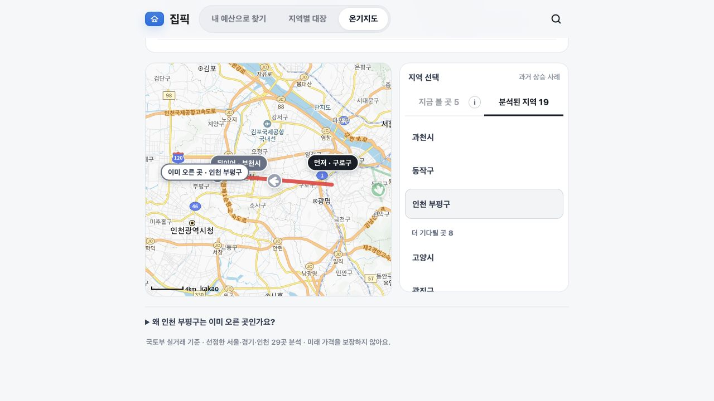
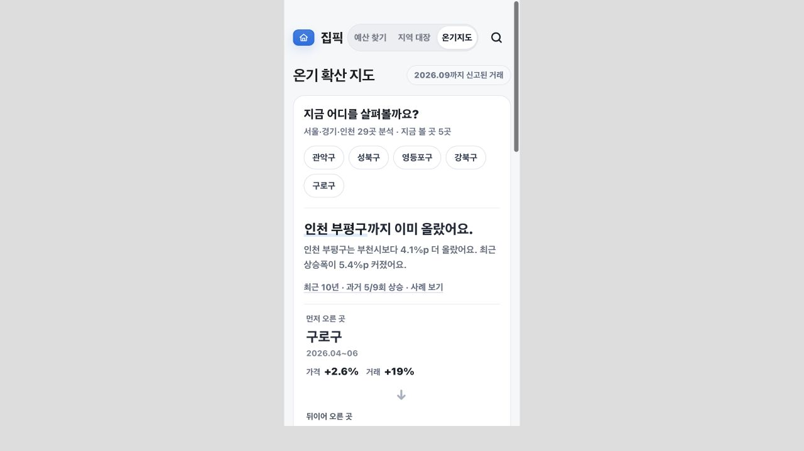

# 인천 분석 범위를 넓혔어요. 일부 가격·전세 자료는 아직 부족해요

확인일: **2026-10-26**. 작업 범위: T1~T5, T9. 로컬 검증 결과이며 운영 배포는 하지 않았습니다.

## 이번에 달라진 점

| 작업 | 반영 내용 | 확인 결과 |
| --- | --- | --- |
| T1 교육 접근성 | 인천 허용, 기존 파일명 유지, 카카오 키가 없으면 점수 생성 중단 | 인천 4곳 실제 조회·저장. 모두 96점. 실제 학교 배정과 구분하는 문구 추가 |
| T2 지역 흐름 | 부천→인천 부평→인천 계양, 인천 연수→남동→미추홀 경로와 인접 쌍 추가 | API와 화면에 인천 5개 구 포함. 기존 노드 코드 유지. 이전 캐시에 인천이 없어 스냅샷 버전 9로 변경 |
| T3 실거래 미리 받기 | 기본 지역에 인천 추가 | 기존 단지 목록의 10개 구·군 코드 모두 포함. 240개 지역·월 중 최신 캐시 198개 확인. 전체 수집 완료는 아님 |
| T4 분양권·입주예정 보강 | LH 조회 지역, 청약홈 필터, 인천 주소 색인과 중복 구명 구분 보강 | 인천 1→49행. 모두 입주예정. 기존 서울·경기 행 보존. 분양권 실거래 가격 검증은 남음 |
| T5 생활권 목록 | 인천 공급 공고 포함, 인천 주소·법정동·지번 완전일치로 좌표 확인 | 인천 공급 공고 71건. 기존 철도·서울·경기 검토 자료 보존. 직접 수혜나 예정역 출입구로 해석하지 않음 |
| T9 화면 문구 | 실제 범위에 맞춰 서울·경기·인천 표기, 주변 학교 기준과 정비구역 미연결 안내 | 데스크톱·375px 화면에서 인천 부평구 선택, 줄바꿈, 지도 이동·더블클릭 확대 확인 |

T4·T5의 전체 재생성은 기존 서울·경기 자료도 바꿨습니다. 전체 단지 점검에서 서울 단지 번호 표기가 달라진 것을 찾아 인천만 갱신하는 옵션으로 보완했습니다. 이후 전체 단지 식별 점검은 통과했습니다.

## 실제 단지 리포트 결과

아래 점수는 현재 확보한 자료만으로 계산합니다. 자료 부족은 낮은 점수와 다릅니다. 가격 비교가 되는지와 가격이 좋은지는 별개의 뜻입니다.

| 섹션 | 송도 | 청라(서구) | 부평 | 미추홀 |
| --- | --- | --- | --- | --- |
| 가격 비교 | 계산 가능 | 자료 부족 | 계산 가능 | 계산 가능 |
| 교육 접근성 | 96점 | 96점 | 96점 | 96점 |
| 현재 데이터 종합 점수 | 55점 | 62점 | 78점 | 75점 |
| 최근 시장 신호 | 52점 | 자료 부족 | 41점 | 43점 |
| 주변 정비사업 | 인천 경계 미연결 | 인천 경계 미연결 | 인천 경계 미연결 | 인천 경계 미연결 |
| 미래 변화 | 자료 부족 | 자료 부족 | 자료 부족 | 자료 부족 |
| 전세가율 | 자료 부족 | 자료 부족 | 자료 부족 | 자료 부족 |

종합 점수는 교육이 포함된 기존 `locationScore` 출력입니다. 새로운 입지 전용 점수를 만든 것은 아닙니다. 정비구역 미연결을 주변 사업 0건으로 바꾸지 않았습니다. 교육은 **배정 학교가 아니라 주변 학교 접근성 기준**입니다.

| 표본 | 고유 ID | 법정동 / 지번 |
| --- | --- | --- |
| 송도 더샵 퍼스트파크 F15BL | `28185120358884` | 송도동 / 102 |
| 청라제일풍경채2차에듀앤파크 | `28260120359412` | 청라동 / 149-2 |
| 부평 두산위브 더파크 | `28237120449207` | 산곡동 / 534 |
| 인천 SK Sky VIEW | `28177120339094` | 용현동 / 664 |

| 섹션 | 서울 헬리오시티 | 경기 판교푸르지오그랑블 |
| --- | --- | --- |
| 가격 비교 | 계산 가능 | 자료 부족 |
| 교육 접근성 | 96점, 기존과 같음 | 96점, 기존과 같음 |
| 현재 데이터 종합 점수 | 76점 | 77점 |
| 최근 시장 신호 | 47점, 기존과 같음 | 자료 부족, 기존과 같음 |
| 주변 정비사업 | 기존 서울 자료 범위 | 기존 경기 자료 범위 |
| 미래 변화 | 자료 부족 | 자료 부족 |
| 전세가율 | 자료 부족 | 자료 부족 |

기존 8767 서버와 검증 서버 8768 응답을 비교했습니다. 두 표본의 교육 결과·시장 신호는 같습니다. 헬리오시티 비교 단지에는 작업 전부터 미커밋 상태였던 비교 근거 보강 코드가 실행돼 설명 필드가 달라졌습니다. 이는 이번 작업 커밋에 포함하지 않았습니다. 따라서 모든 응답 필드가 완전히 같다고 주장하지 않습니다.

## 실거래 미리 받기 결과

기본 24개월 × 인천 기존 10개 구·군 = **240개 지역·월 조합**이 추가됩니다. 실제 실행은 최신 캐시 163개에서 시작했습니다. API 페이지를 77회 호출한 뒤 198개가 최신 캐시로 확인됐습니다. 42개는 최신 캐시가 확보되지 않았습니다. 미리 받기 함수의 완료 반환값은 만료 캐시 대체 응답을 포함할 수 있어 최신 확보 건수와 다릅니다.

| 기존 코드 지역 | 최신 캐시 미확보 |
| --- | ---: |
| 중구 `28110` | 1개월 |
| 동구 `28140` | 16개월 |
| 강화군 `28710` | 10개월 |
| 옹진군 `28720` | 15개월 |
| 미추홀·연수·남동·부평·계양·기존 서구 | 0개월 |

배포 설정에서 `BUDGET_PREWARM_REGIONS` 별도 덮어쓰기는 찾지 못했습니다. 공급 보정은 기존대로 준공 자료와 같은 지역 집합만 나눕니다. 인천 공급이 늘었다고 서울·경기 보정 분모에 섞지 않습니다.

## 검증

- 지침서의 unittest 명령: **224개 통과**. `PYTHONPATH=pipeline`을 지정했습니다.
- 같은 9개 모듈의 pytest: **297개, 하위 검사 3개 통과**. 생활권·미래 변화 모듈은 pytest 함수도 있어 unittest만으로는 전부 실행되지 않습니다.
- HTTP 테스트는 샌드박스에서 포트 바인딩이 차단돼 로컬 네트워크가 허용되는 환경에서 재실행했습니다.
- 전체 단지 식별 점검: 통과. 단지 번호 누락 0, 알려진 오연결 0, 섹션 식별 오류 0. 기존 미해결 위치 검토 3건은 남아 있습니다.
- 지도 점검: 표시 경계 2,590개, API와 리포트 불일치 0. 인천 경계는 여전히 미연결입니다. 원본 도형 오류 등 기존 미확인 항목은 유지했습니다.
- 가격 커버리지 점검은 캐시 기준 현황 조사입니다. 모든 단지의 가격 확보를 보장하지 않습니다.
- 화면: 데스크톱 및 375px iframe에서 인천 부평구 선택·지도 노드·문구 줄바꿈·드래그 이동·더블클릭 확대 확인. 실제 휴대전화의 손가락 제스처 검사는 아닙니다.

[검증 요약 JSON](incheon-coverage-validation.json)에 단지별 실제 응답 상태와 수집 수치를 남겼습니다. 전체 점검 원본은 이번 세션의 `/tmp/incheon-baseline/`에 있습니다.





## 남은 작업

1. **T3 전체 최신 캐시 확보:** 위 42개월을 모두 확보했다고 표시하지 않습니다.
2. **T4 분양권 가격:** 추가 49행은 입주예정 공고입니다. 인천 분양권 실거래로 가격이 나오는 사례는 아직 검증하지 못했습니다.
3. **기존 교육 출처 표기 1건:** 작업 전 기록 중 `basis: nearby_school_access`인데 `source`에 학구도 안내서비스가 적힌 1건을 확인했습니다. 새 인천 기록은 `kakao-local-v2`입니다. 기존 기록의 원출처를 추정해 덮어쓰지 않았습니다.
4. **행정구역 개편:** [인천시 공식 개편 안내](https://www.incheon.go.kr/IC01070101)에서 2026년 개편을 확인했습니다. 현재 저장소의 2025 단지 목록과 기존 국토부 코드로 검증했습니다. 새 행정구역과 과거 코드 연결은 별도 검증이 필요합니다. T2는 개편 영향을 받지 않는 구를 선택했습니다. 인접성은 [인천 공식 I-MAP](https://imap.incheon.go.kr/sgp/rst/view.do?layer=prc), 새 구 노드 좌표는 카카오 구청 대표점으로 확인했습니다.
5. **T6~T8:** 지침서대로 출처·이용 허락 조사 결과를 먼저 보고한 뒤 승인받아 진행할 단계입니다. 인천 정비 경계·미래 변화 사업 등록·네이버 수집·전세 자료 추가는 아직 진행하지 않았습니다.

재생성 명령:

```bash
.venv/bin/python pipeline/build_presale_supplement.py --incheon-only
PYTHONPATH=pipeline .venv/bin/python pipeline/import_living_area_metro.py --incheon-supply-only
```
